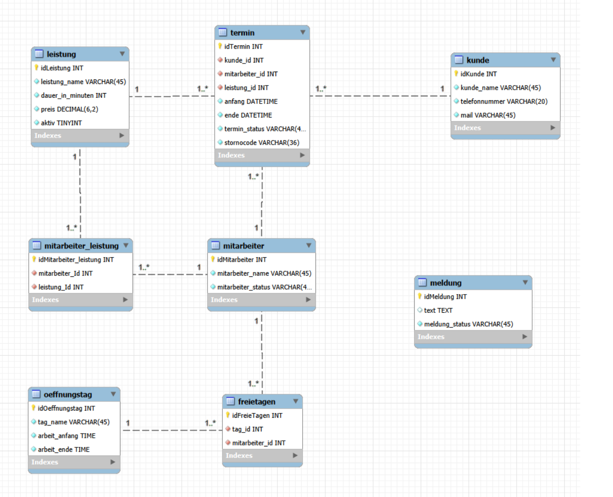

# Schnittpunkt – Online-Terminbuchung für einen Friseursalon

Webanwendung für den Friseursalon Schnittpunkt. Kundinnen und Kunden buchen online einen Termin mit Leistung, Person (oder „egal“), Datum und Uhrzeit und können ihn mit einem Stornocode wieder absagen. Das Salon-Team sieht in einem passwortgeschützten Bereich die Tagesübersicht, setzt Termine auf erledigt oder storniert und pflegt die Leistungen.

## Funktionen

**Für Kunden**
- Startseite mit Leistungen, Preisen und Öffnungszeiten
- Buchung in vier Schritten: Leistung, Person oder „egal“, Datum und freie Uhrzeit, Kontaktdaten
- Es werden nur freie Zeiten angeboten. Personen, die eine Leistung nicht anbieten, sind gesperrt.
- Stammkunden buchen nur mit ihrer E-Mail-Adresse
- Nach der Buchung erscheint ein Stornocode
- Stornieren mit dem Stornocode bis 24 Stunden vor dem Termin

**Für den Salon** (Passwort)
- Tagesübersicht mit einer Spalte pro Person, Blättern zwischen den Tagen
- Termine als erledigt oder nicht erschienen markieren oder stornieren (ohne Frist)
- Leistungen anlegen, Name, Dauer und Preis ändern, aktiv oder inaktiv schalten

## Umgesetzte Bonuspunkte

- Freie Tage pro Mitarbeiter, die bei den freien Zeiten und beim Buchen berücksichtigt werden (Tabelle `freietagen`)
- Status „nicht erschienen“ im Salon-Bereich (ohne Auswertung)
- Responsive Darstellung für Smartphones

## Technik

- **Backend:** Node.js, Express 5, MySQL 8 mit `mysql2`
- **Frontend:** HTML, CSS, JavaScript mit `fetch`
- **Aufbau des Backends:** Schichtenmodell Router → Controller → Service → Repository
- Doppelbuchungen werden beim Speichern durch eine Transaktion mit Zeilensperre (`SELECT ... FOR UPDATE`) verhindert.

## Voraussetzungen

- Node.js ab Version 20.12 (wegen `process.loadEnvFile`)
- MySQL 8

## Installation und Start

1. **Datenbank anlegen:** Das Skript legt die Datenbank `schnittpunkt_salon`, alle Tabellen und Testdaten an.
   ```
   mysql -u root -p < datenbank/schema.sql
   ```
   Alternativ in MySQL Workbench: *File → Open SQL Script*, `datenbank/schema.sql` öffnen und ausführen.

2. **Pakete installieren:**
   ```
   cd backend
   npm install
   ```

3. **Konfiguration:** Im Ordner `backend` die Datei `.env.example` nach `.env` kopieren und ausfüllen:
   ```
   PORT=3000
   DB_HOST=localhost
   DB_USER=root
   DB_PASSWORD=dein_mysql_passwort
   DB_DATABASE=schnittpunkt_salon
   SALON_PASSWORT=ein_passwort_fuer_den_salon
   ```
   Die `.env` steht in der `.gitignore` und wird nicht hochgeladen.

4. **Server starten:**
   ```
   npm start
   ```
   Für die Entwicklung mit automatischem Neustart: `npm run dev`

5. **Im Browser öffnen:** [http://localhost:3000](http://localhost:3000)

   Der Server liefert das Frontend selbst aus. Den Salon-Bereich erreicht man über den Link „Salon-Bereich“ unten auf jeder Seite oder direkt über `http://localhost:3000/salon_logging.html`.

Das Frontend ruft die API unter `http://127.0.0.1:3000/api` auf. Wird ein anderer Port verwendet, muss die Adresse in den Dateien unter `frontend/js/` angepasst werden.

## Testdaten

Die `schema.sql` enthält 3 Mitarbeitende, 6 Leistungen, 20 Kunden und 39 Termine. Am **Dienstag, 24.11.2026** liegen 18 Termine, damit lässt sich die Tagesübersicht gut zeigen. Freie Tage: Sabine samstags, Mara mittwochs, Jonas freitags.

## Projektstruktur

```
Schnittpunkt/
├── backend/
│   ├── index.js              Server-Start, Fehlerbehandlung
│   ├── .env.example          Vorlage für die Einstellungen
│   └── src/
│       ├── router/           Routen, Passwortschutz
│       ├── controller/       Anfrage annehmen, Antwort senden
│       ├── service/          Regeln und Prüfungen
│       ├── repository/       SQL-Abfragen
│       └── util/             Datenbank, Prüfungen, Zeit
├── frontend/
│   ├── index.html            Startseite
│   ├── buchung.html          Termin buchen
│   ├── stornieren.html       Termin stornieren
│   ├── salon_logging.html    Anmeldung Salon-Bereich
│   ├── salon.html            Tagesübersicht, Leistungen
│   ├── style.css             Gestaltung aller Seiten
│   ├── salon.jpg             Bild der Startseite
│   └── js/
│       ├── main.js           Startseite
│       ├── buchung.js        Buchungsseite
│       ├── stornieren.js     Stornoseite
│       ├── salon_logging.js  Anmeldung
│       └── salon.js          Salon-Bereich
├── datenbank/
│   └── schema.sql            Datenbank, Tabellen, Testdaten
└── docs/
    ├── anforderungen.md      Anforderungsliste
    └── er-diagramm.png       ER-Diagramm
```

## Wichtige API-Routen

Alle Pfade beginnen mit `/api`. Geschützte Routen brauchen den Header `x-salon-passwort` mit dem Passwort aus `SALON_PASSWORT`, sonst antwortet der Server mit 401.

| Methode | Pfad | Schutz | Zweck |
|---|---|---|---|
| GET | `/leistung` | öffentlich | Alle Leistungen |
| GET | `/oeffnungstag` | öffentlich | Öffnungszeiten |
| GET | `/mitarbeiter/aktiv` | öffentlich | Aktive Mitarbeitende (nur ID und Name) |
| GET | `/mitarbeiter_leistung/leistung/:id` | öffentlich | Wer bietet eine Leistung an |
| GET | `/termin/:idLeistung/:idMitarbeiter` | öffentlich | Freie Zeiten bei einer Person |
| GET | `/termin/egal/:idLeistung` | öffentlich | Freie Zeiten bei „egal“ |
| POST | `/termin` | öffentlich | Termin buchen |
| POST | `/termin/storno` | öffentlich | Termin mit Stornocode stornieren |
| GET | `/termin/tag?datum=JJJJ-MM-TT` | Passwort | Tagesübersicht |
| PATCH | `/termin/:id/status` | Passwort | Status setzen (erledigt, nicht erschienen, storniert) |
| POST | `/leistung/neu` | Passwort | Leistung anlegen |
| PATCH | `/leistung/update/:id` | Passwort | Leistung ändern |
| POST | `/mitarbeiter_leistung/neu` | Passwort | Person einer Leistung zuordnen |

Fehler kommen immer als `{ "error": "Text" }` mit passendem Statuscode (400, 401, 404, 409).

## Annahmen und Entscheidungen

Das Gesprächsprotokoll lässt einige Punkte offen. So wurden sie gelöst:

- **Kunden wiedererkennen:** über die E-Mail-Adresse. Bei „Waren Sie schon einmal bei uns?“ → „Ja“ reicht die E-Mail. Bei „Nein“ werden Name und Telefon gespeichert bzw. aktualisiert.
- **„egal“:** Es wird die erste freie Person in der Reihenfolge der ID gewählt, die die Leistung anbietet.
- **Stornieren ohne Login:** Jeder Termin bekommt einen zufälligen Stornocode (UUID). Nur wer den Code kennt, kann den Termin stornieren. Der Code wird nach der Buchung angezeigt, da es keine Bestätigungs-E-Mail gibt.
- **Stornierte Termine** werden nicht gelöscht, sondern bekommen den Status `storniert` und bleiben in der Tagesübersicht sichtbar. Zusätzlich gibt es den Status `nicht erschienen`.
- **Leistungen** werden deaktiviert statt gelöscht, damit alte Termine ihre Leistung behalten. Der Preis wird nicht im Termin gespeichert. Preisänderungen gelten für die Anzeige.
- **Freie Tage** gelten wöchentlich und für den ganzen Tag. Pausen und Feiertage werden nicht berücksichtigt.
- **Öffnungszeiten** kommen aus der Datenbank und lassen sich über die API (`PATCH /oeffnungstag/update/:id`) ändern. Eine Oberfläche dafür gibt es nicht.
- **Zeitzone:** Der Server muss in deutscher Zeit (Europe/Berlin) laufen.

## Bekannte Einschränkungen

- Der Salon-Bereich ist mit einem gemeinsamen Passwort geschützt, wie gewünscht. Es gibt keine Benutzerkonten, keine gehashten Passwörter und kein HTTPS. Für den echten Betrieb müsste das ergänzt werden.
- Das Passwort liegt nach der Anmeldung im `sessionStorage` des Browsers und wird beim Schließen des Tabs oder mit „Abmelden“ gelöscht.
- Bei „Ja“ mit einer unbekannten E-Mail meldet die Seite, dass die E-Mail nicht bekannt ist. Daran lässt sich erkennen, ob eine Adresse gespeichert ist.
- Nicht umgesetzt: Bestätigungs-E-Mail (W-01), mehrere Leistungen in einem Termin (W-02), zeitlich begrenzte freie Tage (W-03, teilweise).
- Bei bestehenden Leistungen lässt sich im Salon-Bereich nicht ändern, wer sie anbietet. Das geht nur beim Anlegen einer neuen Leistung.
- Telefonnummer und Instagram-Link auf der Startseite sind Platzhalter.
- Die Tabelle `meldung` (Kaffeemaschine) und ihre Routen sind vorhanden, gehören aber nicht zum Auftrag und haben keine Oberfläche.

## Dokumentation

- [Anforderungsliste](docs/anforderungen.md)

## ER-Diagramm



## Hinweis

Bei der Umsetzung wurde KI unterstützend eingesetzt. Das Foto auf der Startseite ist KI-generiert.
